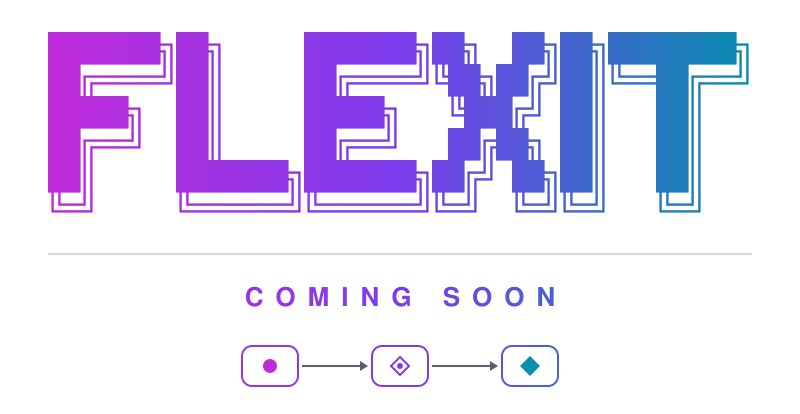

<p align="center">
  
</p>

<p align="center">
  <picture>
    <source media="(prefers-color-scheme: dark)" srcset="assets/banner-dark.svg">
    
  </picture>
</p>

<p align="center">
  
</p>

```text
  ─────────────────────────────────────────────
    Flexit │ coming soon
  ─────────────────────────────────────────────
```

This repository will host the public parts of **Flexit**.

There is nothing to see yet. Check back soon.
